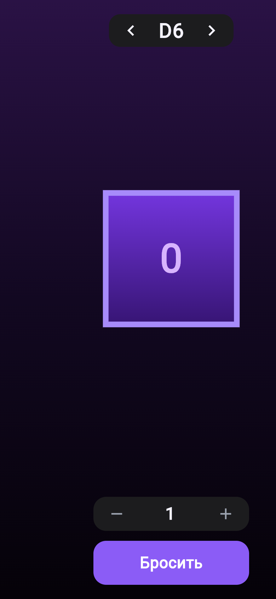

# Лабораторная работа №6. Бросок кубиков

Приложение-кубик: выбираешь тип кубика (d4, d6, d8, d10, d12, d20, d100), задаёшь количество и бросаешь. Результат рисуется фигурой выбранного кубика, а если бросаешь несколько — под суммой появляется расшифровка вида `3 + 5 + 4`.

Цель работы — собрать небольшое приложение целиком самому: своё дерево виджетов, состояние на `setState()`, кастомная отрисовка через `CustomPainter` и подключение картинок через `pubspec.yaml`.

## Автор

Окишев М. С., группа ИСП-242, 23.10.2026

## Скриншот



## Стек и среда разработки

- Flutter 3.47.7
- Dart 3.13.5
- Платформа: Web (Chrome)
- IDE: VS Code

## Структура проекта

```text
lib/
├── main.dart                     — точка входа, MaterialApp и тёмная тема
├── screens/
│   └── dice_screen.dart          — экран броска: состояние и вся логика
├── data/
│   └── dice_types.dart           — список доступных кубиков
├── theme/
│   └── app_colors.dart           — палитра приложения
└── widgets/
    ├── gradient_background.dart  — фон с вертикальным градиентом
    ├── dice_selector.dart        — переключатель типа кубика «‹ D6 ›»
    ├── dice_shape.dart           — фигура кубика с числом результата
    ├── dice_painter.dart         — отрисовка фигур через CustomPainter
    ├── count_stepper.dart        — счётчик количества с полем ввода
    └── roll_button.dart          — кнопка «Бросить»

assets/images/                    — изображения кубиков (d20_icon, dice_trio, dice_pattern),
                                    подключены в pubspec.yaml
img/                              — скриншоты для README
```

## Как запустить проект

```bash
git clone https://github.com/Korand-py/flutter_lab6.git
cd flutter_lab6
flutter pub get
flutter run -d chrome
```

## Что изучили

- Как разложить экран на мелкие виджеты и развести их по файлам, чтобы `main.dart` остался коротким.
- Чем `StatefulWidget` отличается от `StatelessWidget` на практике: в первом лежит изменяемое состояние, второй просто рисует то, что ему передали.
- Как передавать данные и колбэки вниз по дереву через конструктор, чтобы дочерние виджеты не знали лишнего.
- Как работает `CustomPainter`: `Canvas`, `Path`, `Paint` и зачем нужен `shouldRepaint`.
- Как собрать фон через `LinearGradient` и вынести цвета в один класс-палитру.
- Как получить случайное число через `Random` из `dart:math` и сложить результаты нескольких бросков.